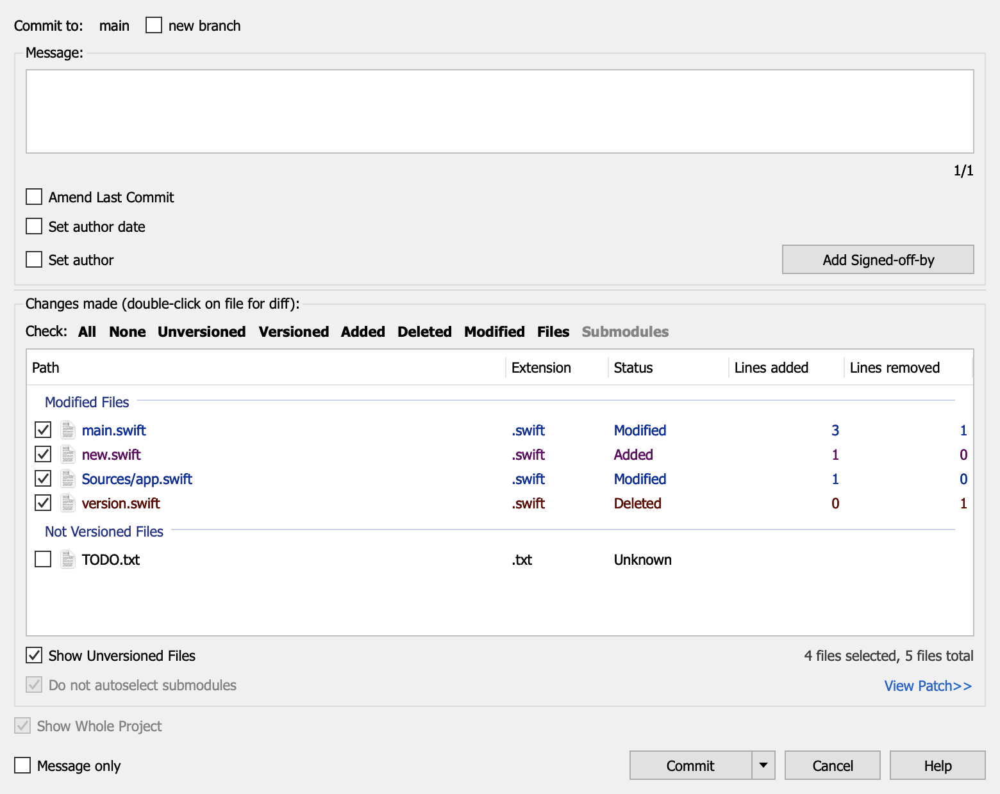
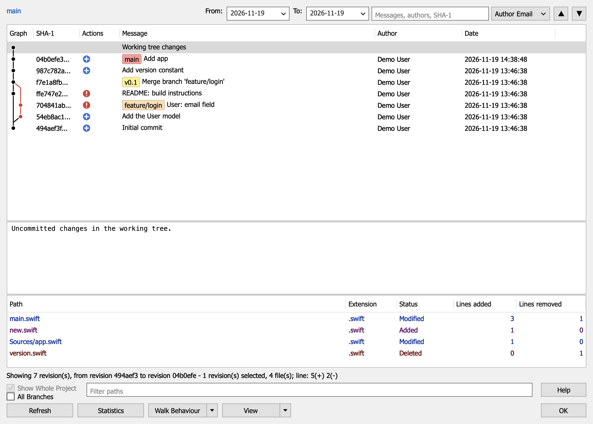
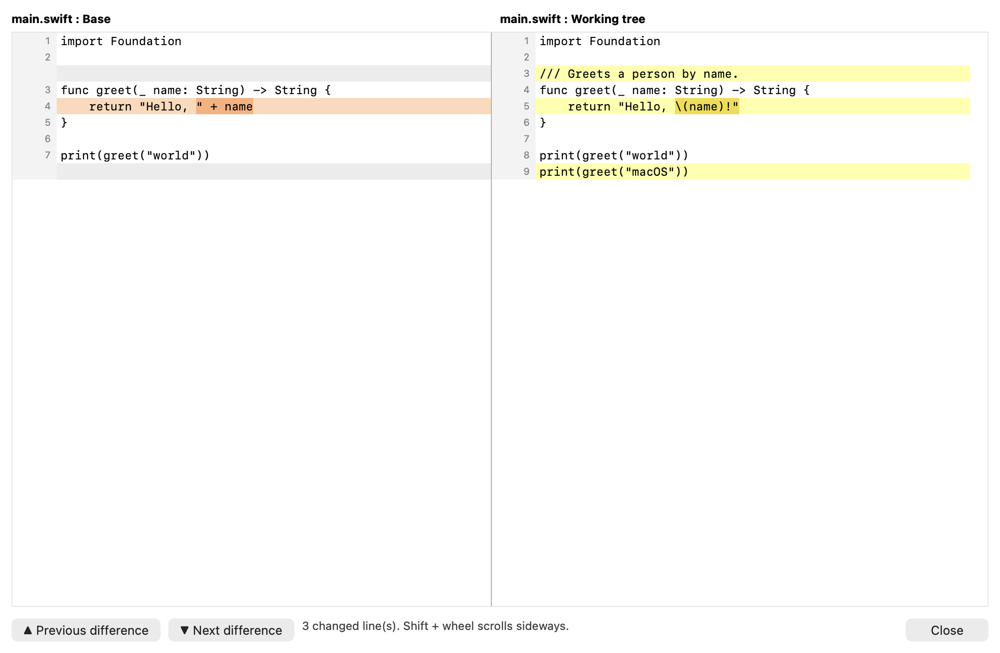

# WTortoise

Git from the Finder right-click menu, in the spirit of TortoiseGit on Windows: pick a folder or a
file, choose **Commit**, **Show log**, **Diff**, **Push**… and a small window does that one job.
No big repository browser to keep open — Finder is the browser.

> **Windows-style utilities for macOS** — one set, each works on its own:  
> [WExplorer](https://github.com/opewix/wexplorer) — file manager  
> [WTaskbar](https://github.com/opewix/wtaskbar) — taskbar and Start menu instead of the Dock  
> [WPhoto](https://github.com/opewix/wphoto) — picture viewer  
> **WTortoise** — Git in the right-click menu, like TortoiseGit







## Features

- **Finder menu**, laid out like on Windows. Inside a working tree: *Git Sync…*,
  *Git Commit -> "branch"…* and a **WTortoise** group with Pull, Fetch, Push, Diff, Show log, Check for
  modifications, Stash, Stash List, Reflog, Browse References, Resolve, Rename, Delete, Revert, Clean up, Reset, Switch/Checkout, Merge, Create Branch, Create Tag,
  Add and Blame, in TortoiseGit's order. Outside one: *Git Clone…* and *Git Create repository here…*.
- **The same menu and status badges in [WExplorer](https://github.com/opewix/wexplorer)**, the
  Windows-style file manager: it shows them on its own once WTortoise is installed.
- **Status badges** on files and folders in Finder: unchanged, modified, added, conflicted.
- **Commit:** message, list of changed files with checkboxes, lines added and removed, *Amend Last
  Commit*, *Commit & Push*. Only the checked files go into the commit, whatever is staged.
  Double-click a file to see its diff; right-click to revert it, add it or ignore it.
- **Log:** commit graph with branch and tag labels, filter by message, author or SHA-1, the full
  message and the changed files of the selected commit. Right-click a commit to switch to it,
  create a branch or a tag there, reset, revert or cherry-pick it.
- **Diff:** two panes, before and after, with the changed lines and the changed part of each line
  highlighted; F7 / F8 jump between differences.
- **Blame:** who last changed each line of a file, and in which commit.
- **Rename** and **Delete** under version control (`git mv`, `git rm`).
- **Push, Pull, Fetch, Clone** with live output from git, including transfer progress.
- **Passwords and SSH passphrases** are asked in a window; credential helpers (the macOS keychain)
  and the SSH agent work as in the terminal. If the server denies access (wrong saved account,
  error 403), the progress window offers **Sign in...**: enter a username and a password or token,
  and the command runs again; the login can be remembered for that repository.
- **Diffs in [WMerge](https://github.com/opewix/wmerge)**, if you have it: turn on *Use WMerge to compare files* in
  Settings and file comparisons open there instead of the built-in diff window.
- The app runs the `git` you already have, so its behavior matches the command line.
- English by default, with the wording of TortoiseGit; Russian can be turned on in Settings.

## Install

1. Download `wtortoise-<version>.dmg` from [Releases](https://github.com/opewix/wtortoise/releases).
2. Open it and drag **WTortoise** to **Applications**.
3. The app is not notarized by Apple, so macOS blocks the first launch. Open it once, then go to
   **System Settings → Privacy & Security** and click **Open Anyway**. Or run:

   ```sh
   xattr -dr com.apple.quarantine /Applications/WTortoise.app
   ```

4. Turn on the Finder menu: open **WTortoise**, click **Finder Extensions…** and enable
   **WTortoise** (System Settings → General → Login Items & Extensions → File Providers / Finder).

Requires macOS 13 Ventura or later and git (Xcode Command Line Tools or Homebrew).

## Without Finder

Open **WTortoise** itself: choose a folder and click a command. Or from a terminal:

```sh
open "wtortoise://log?path=$PWD"
/Applications/WTortoise.app/Contents/MacOS/WTortoise -command commit -path .
```

Commands: `commit`, `pull`, `fetch`, `push`, `diff`, `log`, `status`, `blame`, `add`, `revert`,
`rename`, `delete`, `switch`,
`merge`, `branch`, `tag`, `stash`, `stashpop`, `clone`, `init`, `settings`, `about`.

## Build from source

Only the Swift toolchain is needed (Xcode Command Line Tools), no Xcode project.

```sh
swift build                                            # debug build of the app
./scripts/bundle.sh                                    # build/WTortoise.app with the Finder extension
VERSION=0.1 ./scripts/make-dmg.sh                      # build/wtortoise-0.1.dmg
.build/debug/WTortoise -snapshot <dir> -path <repo>    # render the windows to PNG
```

The Finder extension is sandboxed, as macOS requires, with read-only access to the disk: it looks
for `.git` and runs `git status` to draw the badges. It never changes anything — every command
opens the app.

## License

[MIT](LICENSE). Free to use, modify and distribute; provided as is, without any warranty.

## Disclaimer

WTortoise is an independent project, not affiliated with or endorsed by the TortoiseGit project,
Microsoft or Apple. It ships no TortoiseGit code or artwork: all graphics are drawn by the app
itself.
